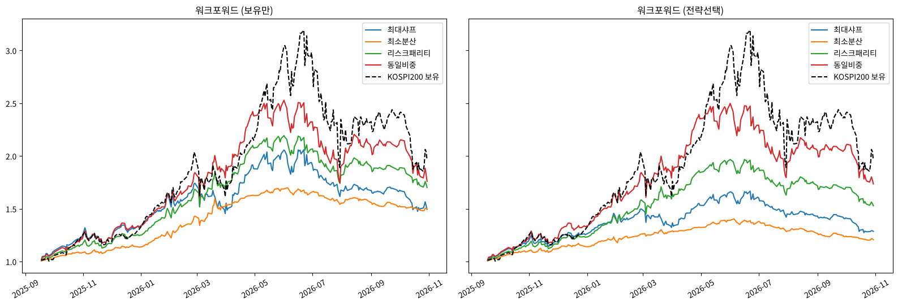

# 📈 내 보유 종목에 퀀트 전략을 적용했다면?

**실제로 들고 있는 13개 종목(국내 주식 + ETF)에 이동평균 전략과 포트폴리오 최적화를 적용해 보고, '미래를 모르는 상태'에서도 효과가 있었는지 워크포워드로 검증한 프로젝트**

> **English summary** — I backtested a moving-average crossover strategy and several portfolio-weighting methods (max-Sharpe MPT, minimum variance, risk parity, equal weight) on the 13 Korean stocks/ETFs I actually hold (Sep 2024 – Oct 2026), including transaction costs and Korean securities transaction tax. A walk-forward test, where every decision uses only past data, showed that the trend strategy reduced drawdowns but lowered risk-adjusted returns, that max-Sharpe optimization was the least stable, and that covariance-only methods (min-variance, risk parity) consistently cut drawdowns (min-variance MDD −12.9% vs −31.0% equal weight and −41.9% KOSPI200). No method beat simply holding KOSPI200 in raw return during this strong bull market.

## 왜 만들었나

2024년 9월부터 주식 투자를 하다가 퀀트 트레이딩에 관심이 생겼습니다. 이론부터 읽기보다, **지금 내가 들고 있는 종목에 퀀트 방식을 적용했다면 어떻게 됐을지** 직접 확인해 보고 싶었습니다.

1. 추세 추종 전략(이동평균 교차)이 그냥 들고 있는 것보다 나았을까?
2. 현대 포트폴리오 이론(MPT)으로 비중을 정했다면 결과가 좋아졌을까?
3. 그 결과는 미래를 모르는 상태에서도 재현될까?

## 결과



워크포워드 검증 (2025-09-18 ~ 2026-10-30, 270거래일, 분기 리밸런싱 5회, 거래 비용 포함)

| 방법 | CAGR | 샤프 | 최대 낙폭 |
|---|---|---|---|
| 최소분산 | 45.6% | **2.23** | **−12.9%** |
| 리스크패리티 | 64.2% | 1.79 | −22.4% |
| 동일비중 | 69.6% | 1.47 | −31.0% |
| 최대샤프 (MPT) | 45.5% | 1.17 | −28.4% |
| KOSPI200 보유 | **87.5%** | 1.31 | −41.9% |

1. **이동평균 전략은 수익을 줄이는 대신 낙폭을 줄였습니다.** 13개 중 10개 종목에서 최대 낙폭이 작아졌지만, 샤프 지수가 나아진 종목은 4개뿐이었습니다. 워크포워드에서 과거 성과로 전략을 골라 쓰면 비중 방법 4개 중 3개에서 샤프 지수가 오히려 낮아졌습니다(나머지 하나는 거의 같음).
2. **기대수익률을 쓰는 최대샤프 최적화가 가장 불안정했습니다.** 비중이 시점마다 0%와 상한(20%) 사이를 크게 오갔고, 기본 설정에서 샤프 지수가 동일비중보다 낮았습니다(설정 4가지 중 2가지에서만 동일비중보다 높음). 과거 1년 평균 수익률이 다음 기간을 잘 예측하지 못하기 때문입니다.
3. **공분산만 쓰는 방법은 낙폭을 꾸준히 줄였습니다.** 리밸런싱 주기(월/분기)와 과거 데이터 기간(6개월/1년)을 바꾼 4가지 설정 모두에서 최소분산·리스크패리티·최대샤프의 최대 낙폭이 동일비중보다 작았습니다.
4. **수익률 자체로는 KOSPI200을 그냥 들고 있는 게 가장 좋았습니다.**

**정리**: 이 종목, 이 기간에서 퀀트 방법은 수익을 늘리는 도구라기보다 **하락 위험을 줄이는 도구**였습니다.

### 최근 하락 구간 (2026-06-22 KOSPI200 고점 이후)

| 방법 | 수익률 |
|---|---|
| 최소분산 | **−10.0%** |
| 리스크패리티 | −20.6% |
| 최대샤프 | −26.0% |
| 동일비중 | −28.4% |
| KOSPI200 보유 | −38.6% |
| SK하이닉스 보유 | −52.3% |
| SK하이닉스 이동평균 전략 | −64.7% |

SK하이닉스의 이동평균 전략은 고점(291.9만 원) 대비 이미 절반 넘게 떨어진 뒤(140.1만 원)에야 매도 신호가 났고, 반등한 뒤 판 가격보다 비싸게(182.8만 원) 다시 샀다가 또 떨어져(128.8만 원) 팔았습니다. 늦게 팔고 늦게 사는 일이 반복되며 손실이 쌓이는 현상(휩쏘)입니다. 최소분산은 하락 직전 리밸런싱에서 미국 ETF·달러·금 비중이 높아 손실이 작았습니다.

### 추가 실험: 상승장엔 보유, 하락장엔 최소분산으로 갈아탄다면?

KOSPI200의 고점·저점(10% 이상 반대로 움직인 지점)을 사후에 표시해 두고, 하락 전환을 며칠 늦게 알아챘는지에 따라 비교했습니다 (갈아탈 때마다 비용 0.1%).

| 하락 전환을 알아챈 시점 | CAGR | 샤프 | 최대 낙폭 |
|---|---|---|---|
| 정확히 그날 (사후에만 가능) | 204.7% | 3.60 | −10.2% |
| 5일 늦게 | 108.9% | 2.38 | −19.3% |
| 10일 늦게 | 77.2% | 1.81 | −23.9% |
| 20일 늦게 | 49.8% | 1.25 | −33.7% |
| 이동평균으로 판단 (현실적 규칙) | 66.5% | 1.54 | −34.4% |
| *(참고) 동일비중 계속* | *69.6%* | *1.47* | *−31.0%* |

미래를 알면 압도적이지만, 5일만 늦어도 수익이 절반으로 줄고 20일 늦으면 그냥 들고 있는 것보다 나빠졌습니다. 이 기간에는 10% 넘는 고점·저점이 8개월 동안 10번 나올 만큼 국면이 빨리 바뀌었습니다.

## 이 프로젝트로 알게 된 것

- **백테스트는 쉽게 좋아 보입니다.** 첫 버전은 전략 선택에 전체 기간 성과를 써서 미래 정보가 섞여 있었습니다. 모든 결정을 '그 시점까지의 데이터'로만 하도록 바꾸자 이동평균 전략의 효과는 사라졌습니다.
- **예측보다 위험 관리가 재현됐습니다.** 타이밍을 맞히려는 방법(이동평균, 최대샤프, 국면 전환)은 미래를 모르는 상태에서 효과가 없었고, 위험을 나누는 방법(최소분산, 리스크패리티)은 설정을 바꿔도 꾸준히 낙폭을 줄였습니다.
- **위험을 줄이는 데는 대가가 있습니다.** 최소분산은 최대 낙폭을 −31%에서 −13%로 줄였지만, 수익률은 동일비중의 약 3분의 2였습니다.
- **자동화할 것과 하지 말 것.** 처음 목표는 매일 '사세요/파세요'를 알려주는 도구였습니다. 이 결과를 보면 매매 신호보다, 목표 비중에서 크게 벗어났을 때만 조정을 알려주는 위험 관리 도구가 더 근거 있는 방향입니다.

## 방법

| 단계 | 내용 |
|---|---|
| 데이터 | pykrx로 13개 종목 + KODEX 200 종가 수집, 기간 고정(2024-09-01 ~ 2026-10-30) 후 CSV 저장 |
| 이동평균 전략 | 20일 > 60일 이동평균이면 보유, 아니면 현금. 신호는 다음 날 반영 |
| 거래 비용 | 수수료 0.015%(매수·매도), 증권거래세 0.20%(주식 매도, 국내 ETF 면제) |
| 비중 방법 | 최대샤프, 최소분산, 리스크패리티, 동일비중 (종목당 최대 20%) |
| 워크포워드 | 리밸런싱 시점마다 과거 252일만 보고 전략/보유 선택과 비중 결정 → 다음 63일 운용. 리밸런싱 사이 비중 변화와 리밸런싱 비용 반영 |
| 견고성 | 과거 기간 {126, 252}일 × 리밸런싱 {21, 63}일 |
| 국면 전환 | KOSPI200 고점·저점(10% 기준)을 사후 표시, 전환 인지 지연 0/5/10/20일 비교 |

## 한계

- **사후 선택 편향**: 지금 보유 중인 종목으로 과거를 테스트했습니다. 지금 들고 있다는 것 자체가 그동안 성과가 좋았을 가능성이 크다는 뜻이라 결과가 실제보다 좋게 나올 수 있습니다.
- **강한 상승장, 큰 변동성**: 검증 구간에 KOSPI200이 약 2배가 됐고, 하루에 20% 넘게 오르는 날도 있었습니다. 다른 시장 상황에서는 결론이 달라질 수 있습니다.
- **짧은 기간**: 약 2년 데이터, 워크포워드 리밸런싱 5회로 통계적으로 확실한 결론을 내리기엔 표본이 작습니다.
- **단순화**: 배당, 양도세, 슬리피지, 현금 이자는 반영하지 않았고, 이동평균 기간(20/60일)과 비중 상한(20%)은 고정값입니다.

## 다음 단계

- **위험 관리 도구**: 매일 가격을 받아 현재 비중과 목표 비중(예: 보유 종목 70% + 최소분산 30%)의 차이를 계산하고, 기준(예: 5%p)을 넘을 때만 조정을 알려주기
- 하락장·횡보장이 포함된 더 긴 기간과 더 많은 종목으로 재검증

## 개발 과정

처음 버전은 종목별로 전략/보유를 **전체 기간 성과로** 고른 뒤 그 결과를 워크포워드에 넣었습니다. 이렇게 하면 각 시점이 '어느 쪽이 나았는지'를 이미 아는 상태가 되어 검증이 되지 않는다는 걸 발견하고, 선택까지 워크포워드 안에서 과거 데이터로만 하도록 고쳤습니다. 함께 거래 비용, 리밸런싱 사이 비중 변화, 시장 지수 비교, 기대수익률을 쓰지 않는 비중 방법, 설정별 견고성 확인, 국면 전환 실험을 추가했습니다.

## 실행 방법

```bash
pip install -r requirements.txt
jupyter notebook Quant_Portfolio.ipynb      # data/prices.csv를 읽어 그대로 재현됩니다
# 데이터를 다시 받으려면: python data/fetch_prices.py
```

```
├── Quant_Portfolio.ipynb   # 분석 노트북 (설명 + 결과)
├── quant_lib.py            # 전략, 성과 지표, 비중 방법, 워크포워드 함수
├── data/
│   ├── prices.csv          # 종가 데이터 (고정 기간)
│   └── fetch_prices.py     # 데이터 수집 스크립트
└── media/                  # README 이미지
```

> 투자 권유가 아닌 개인 학습 기록입니다. 실제 보유 금액은 공개하지 않고 비중만 기록했습니다.
